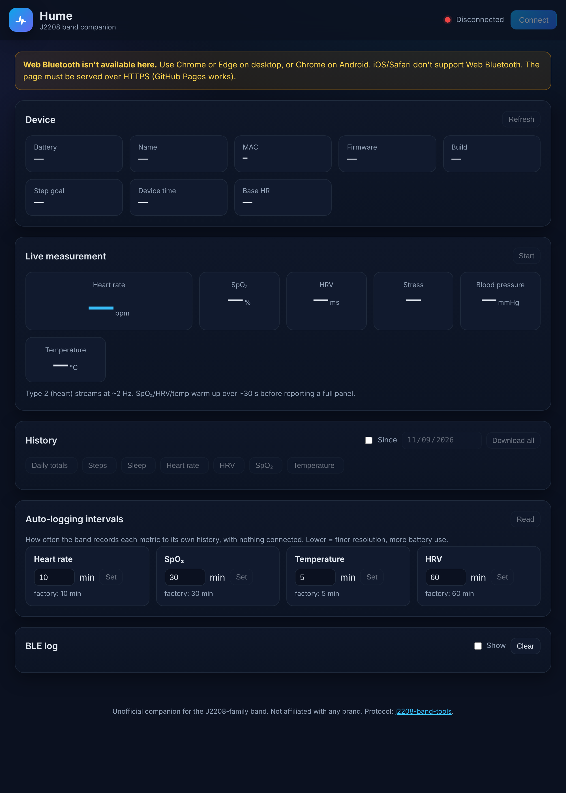

# Hume — J2208 band companion

A browser-based companion app for the **Hume Band V2** and other devices in the
**J2208 fitness-band family**. It talks to the band directly over Bluetooth
using [Web Bluetooth](https://developer.mozilla.org/docs/Web/API/Web_Bluetooth_API)
— no backend, no account, no app store. Your data never leaves your browser.



## What it does

- **Connect** to the band over BLE and read live device state
- **Device panel** — battery, name, MAC, firmware + build date, step goal, on-device clock
- **Live measurement** (`0x28`, ~2 Hz) — heart rate, SpO₂, HRV, stress, blood pressure and temperature, with a live heart-rate chart
- **History download** — steps, heart rate, HRV, SpO₂, temperature, sleep (hypnogram) and daily totals, with charts, summaries and **CSV export**
- **Auto-logging intervals** — read and change how often the band records each metric to its own memory
- **BLE log** — raw TX/RX hex console for debugging

## Running it

Web Bluetooth requires a **secure context (HTTPS)**, except on `localhost`.

### Locally

```bash
# any static server works; from the repo root:
python3 -m http.server 8000
# then open http://localhost:8000
```

### GitHub Pages

Push to GitHub and enable Pages (Settings → Pages → *Deploy from branch*,
root of your default branch). The site is static — nothing to build — and
Pages serves it over HTTPS, which is all Web Bluetooth needs.

## Browser support

| Platform | Support |
| --- | --- |
| Chrome / Edge (desktop, Windows / macOS / Linux / ChromeOS) | ✅ |
| Chrome on Android | ✅ |
| Safari / iOS (any browser) | ❌ Web Bluetooth not implemented |
| Firefox | ❌ Web Bluetooth disabled by default |

The app detects unsupported browsers and shows a notice instead of failing.

## How it works

The band uses the generic `fff0 / fff6 / fff7` GATT profile common to low-cost
Shenzhen fitness bands. The link is **plaintext with no pairing or
authentication** — discover services, enable notifications, send commands.

Commands are always 16 bytes: `opcode`, 14 argument bytes, then an additive
checksum. History is streamed over notifications with a simple paging handshake.
See [`js/protocol.js`](js/protocol.js) for the full encode/decode layer and
[`js/history.js`](js/history.js) for the download state machine.

The protocol was reverse-engineered and documented in
[**brendangooden/j2208-band-tools**](https://github.com/brendangooden/j2208-band-tools/blob/main/PROTOCOL.md);
this app is an independent implementation of that spec. All credit for the
protocol work belongs there.

### Project layout

```
index.html        markup + layout
styles.css        dark theme
js/protocol.js    framing, opcodes, encoders/decoders (BCD, checksum, parsers)
js/ble.js         Web Bluetooth connection manager + request/response helper
js/history.js     history download state machine + record parsers + CSV
js/charts.js      zero-dependency canvas charts (line + sleep hypnogram)
js/app.js         UI controller wiring it together
```

No dependencies, no build step — plain ES modules.

### Tests

The protocol decoders are checked against the example frames in the spec:

```bash
node test/protocol.test.mjs
```

## Notes & limitations

- Only a **Hume-badged V2** has been verified against real hardware (per the
  source spec). Other J2208 devices should answer the same commands but are
  untested.
- Some record types are **empty on V2 firmware** (`0x54`/`0x60`/`0x62` dynamic
  variants, and raw PPG `0x3A`). The app reads the populated equivalents and
  shows "nothing stored" where a type is empty.
- Write commands beyond auto-logging (set time, alarms, personal info) are
  intentionally not exposed, since they modify device state and are untested.

## Disclaimer

This is an **unofficial** tool, not affiliated with or endorsed by any brand.
The band is a consumer fitness device, **not a medical device** — do not use
any reading here for diagnosis or treatment. Use at your own risk.

## License

MIT — see [LICENSE](LICENSE).
